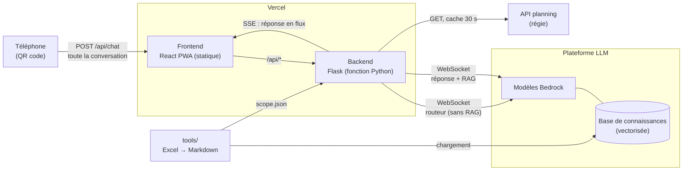
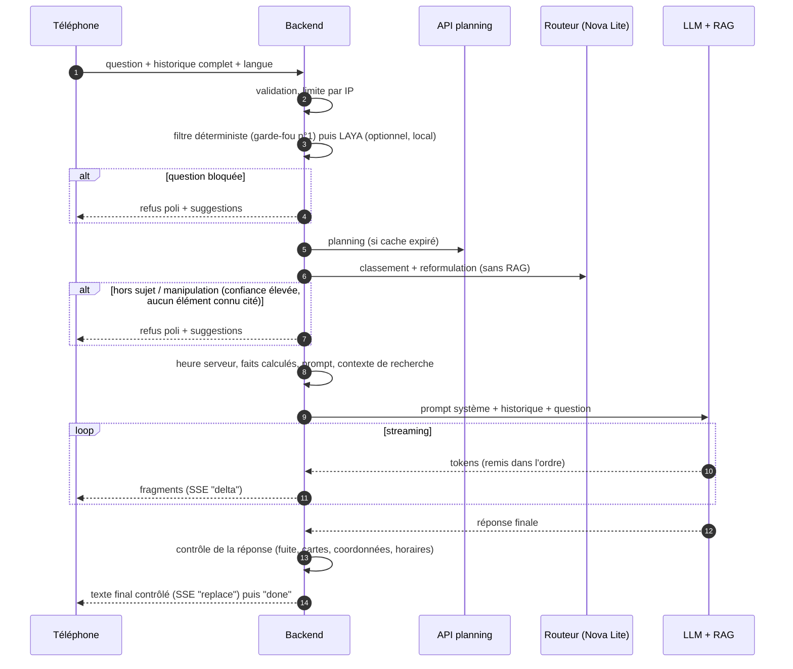

# 01 — Architecture

## Vue d'ensemble



| Composant | Technologie | Responsabilités | Ce qu'il ne fait pas |
|---|---|---|---|
| Frontend | React 19, TypeScript, Vite, Tailwind, PWA | Afficher la conversation, les cartes, les suggestions ; stocker l'historique sur le téléphone ; FR/EN, thème, accessibilité | Aucun appel direct au LLM, aucun secret, aucune règle métier |
| Backend | Python 3.12, Flask, fonction Vercel | Valider, limiter, filtrer, classer, dater, enrichir la question ; appeler le LLM ; contrôler la réponse ; diffuser en SSE | Ne stocke aucune conversation |
| Plateforme LLM | WebSocket, modèles Bedrock, RAG par `workspaceId` | Recherche documentaire et génération | Ne connaît ni l'heure ni le planning en direct (fournis par le backend) |
| API planning | REST (GET, identifiant dans l'URL) | Horaires et statut (`PENDING`, `CURRENT`, `COMPLETED`) des créneaux | — |
| Outils | Python, openpyxl, pypdf | Classeur Excel → base de connaissances + fiche de périmètre ; import LinkedIn (PDF) ; contrôle de cohérence avec le planning | Ne tournent pas en production |

## Parcours d'une question



Le détail de chaque étape est dans [02 — Backend et LLM](02_backend_et_llm.md).

## Données et sources de vérité

| Donnée | Source | Comment elle arrive au LLM | Fait foi pour |
|---|---|---|---|
| Speakers, sessions, partenaires, infos pratiques, documentation | Classeur Excel → `tools build-kb` → base de connaissances | Recherche RAG de la plateforme | Contenus (bios, descriptions, offres) |
| Horaires et statut du jour | API planning de la régie | Injectés dans le prompt par le backend | Horaires, « en cours », « ensuite » |
| Heure courante | Horloge du serveur (Europe/Paris) | Injectée dans le prompt et devant la question | « Maintenant » |
| Noms connus (speakers, partenaires, sessions), coordonnées officielles | `scope.json` généré par `build-kb` | Routeur et contrôle de la réponse | Ce qui existe vraiment dans l'événement |
| Conversation | Téléphone (`localStorage`) | Envoyée en entier à chaque question | Contexte de l'échange |

Hiérarchie en cas de conflit : **planning en direct > base de connaissances** pour les horaires ;
**faits calculés > déduction du LLM** pour tout calcul d'horaire.

## Protocole d'affichage

Le LLM répond en Markdown. Des blocs spéciaux sont transformés en composants par le frontend :

| Bloc | Rendu | Origine du contenu |
|---|---|---|
| ` ```speaker {…} ``` ` | carte speaker (photo, poste, expertises) + fiche détaillée | JSON recopié depuis la base de connaissances |
| ` ```session {…} ``` ` | carte session (horaire, salle, speakers) | idem |
| ` ```partner {…} ``` ` | carte partenaire (logo, secteur, stand, site) | idem |
| ` ```suggestions [...] ``` ` | questions de relance cliquables | rédigées par le LLM |

Événements du flux SSE envoyés au frontend : `delta` (fragment), `replace` (texte complet qui
remplace l'affichage : réponse finale ou corrigée), `error`, `done`, et `debug` en développement.

## Déploiement

- **Un seul projet Vercel** : frontend statique (`frontend/dist`) + fonction Python
  (`api/index.py`, qui charge `backend/src`). Configuration : [`vercel.json`](../vercel.json).
- **Secrets** (clé de la plateforme LLM) : variables d'environnement Vercel, uniquement côté
  backend.
- **Contraintes** : durée de la fonction (60 s dans `vercel.json`, jusqu'à 300 s possibles) à
  partager entre routeur, planning et réponse ; région d'exécution par défaut aux États-Unis
  (une région européenne est recommandée) ; dépendances Python dans `requirements.txt`
  (exporté depuis `backend/uv.lock`). Capacités détaillées : [07](07_vercel_et_laya.md).

Voir [06 — Exploitation](06_exploitation.md) pour la configuration complète.
